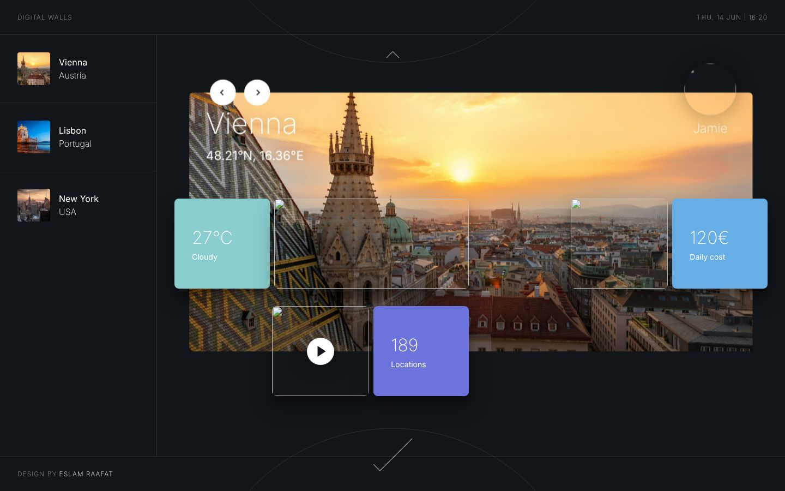
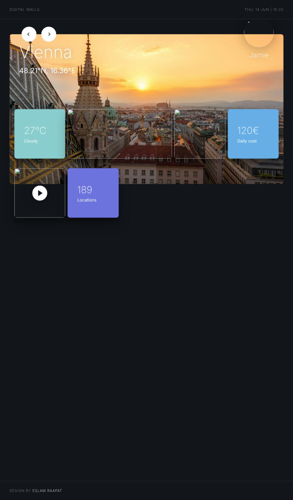

<div align="center">

# Creative Photo — Digital Walls

### City "photo wall" layout built with CSS Grid, scroll snapping and SCSS

A full-screen dashboard-style page that presents three cities (Vienna, Lisbon, New York) as photo walls: a large header image with tiles for weather, daily cost, locations and photos, plus a sidebar and arrow buttons to move between cities.

[](https://developer.mozilla.org/docs/Web/HTML)
[](https://sass-lang.com)
[](https://developer.mozilla.org/docs/Web/CSS/CSS_grid_layout)
[](https://developer.mozilla.org/docs/Web/JavaScript)
<br>
[](https://eslamraafat1.github.io/Creative-Photo/)

**[Live demo](https://eslamraafat1.github.io/Creative-Photo/)** ·
**[Portfolio](https://new-portfolio-ashy-xi.vercel.app/)** ·
**[LinkedIn](https://www.linkedin.com/in/eslamraafat-dev/)** ·
**[Email](mailto:eslamraafat736@gmail.com)**

<br>



</div>

<table>
  <tr>
    <td width="33%"></td>
    <td width="67%"><sub>On desktop the page is a CSS Grid with a fixed header, a city sidebar, the scrolling main area and a footer. Below 1024 px the sidebar is hidden and each city takes the full width.</sub></td>
  </tr>
  <tr>
    <td align="center"><sub>Mobile (iPhone 13)</sub></td>
    <td align="center"><sub>Desktop (1440 × 900)</sub></td>
  </tr>
</table>

---

## Overview

A **practice project** from my 2023 front-end training, used to learn CSS Grid page layout, scroll snapping and SCSS.

It is adapted from Max Böck's CodePen demo for his article ["Layouts of Tomorrow"](https://mxb.at/blog/layouts-of-tomorrow/). The city data (temperatures, costs, location counts) is static placeholder content. Despite the repository name, it is not a photography portfolio.

## Features

- **CSS Grid page layout:** header, sidebar navigation, main content and footer placed with `grid-template-rows` / `grid-template-columns`.
- **Scroll snapping:** the main area uses `scroll-snap-type` so each city section snaps into place.
- **Two ways to move between cities:**
  - the sidebar links (`data-scroll-to`) smoothly scroll to a city and update the current index,
  - the large up / down arrows (`data-scroll-dir`) go to the previous or next city.
  
  The round arrow buttons in each city header are visual only.
- **Auto-fit tile grid:** `repeat(auto-fit, minmax(150px, 1fr))` with wide (`--wide`) and offset (`--push`) tiles for weather, photos, a video tile, daily cost and location count.
- **Responsive breakpoints** at 768, 1024 and 1280 px.

## Tech stack

| Layer | Tools |
| --- | --- |
| Markup | HTML5, single page (`index.html`) |
| Styling | SCSS (`style.scss`) compiled to `style.css`, CSS Grid, scroll snap |
| Scripting | Vanilla JavaScript (`index.js`) |
| Also linked | Bootstrap 5.2.0 and jQuery 3.6.1 (the layout uses its own BEM classes, not Bootstrap's) |
| Images | Lonely Planet images (city headers) and Unsplash Source (tiles) |
| Hosting | GitHub Pages |

## SCSS architecture

- **`style.scss`** (about 450 lines) is the single entry file:
  - **Design tokens as variables:** layout sizes (`$header-height`, `$section-height`, `$nav-width`, `$footer-height`), spacing and radius (`$default-spacing`, `$border-radius`) and a small palette (`$gray-dark`, `$gray`, `$gray-light`, `$indigo`, `$teal`, `$lightblue`).
  - **BEM blocks** (`.header`, `.nav`, `.section`, `.boxgrid`, `.box`, `.arrow`, `.scrollctrl`) with nested modifiers such as `.boxgrid__item--wide` and `.box--weather`.
  - **Nested media queries** inside each block for the 768 / 1024 / 1280 px breakpoints.
- **`_header.scss`** is a partial that is not imported yet.
- **`style.css`** and **`style.css.map`** are the compiled output linked from `index.html`.

## Project structure

```text
.
├── index.html            # header, city sidebar, three city sections, footer
├── index.js              # smooth scrolling between sections
├── style.scss            # SCSS source
├── _header.scss          # partial (not imported)
├── style.css             # compiled CSS
├── style.css.map         # source map
├── bootstrap.min.css · bootstrap.bundle.min.js · jquery-3.6.1.min.js
├── photo/                # images not referenced by the page
└── docs/screenshots/     # README images
```

## Getting started

```bash
git clone https://github.com/Eslamraafat1/Creative-Photo.git
cd Creative-Photo
npx serve .        # or open index.html in a browser
```

To edit the styles, recompile the SCSS:

```bash
npx sass style.scss style.css --watch
```

## Deployment

Served by **GitHub Pages** from the default branch: [eslamraafat1.github.io/Creative-Photo](https://eslamraafat1.github.io/Creative-Photo/).

## Known limitations

- The tile and avatar images use `source.unsplash.com`, which Unsplash has shut down, so those tiles now show broken images (visible in the screenshots).
- The date in the header ("Thu, 14 Jun | 16:20") is static text.

## Credits

Layout adapted from Max Böck's ([@mxbck](https://twitter.com/mxbck)) CodePen demo for ["Layouts of Tomorrow"](https://mxb.at/blog/layouts-of-tomorrow/).

## Author

**Eslam Raafat** — Front-End Developer (React · Next.js · TypeScript)

- **Portfolio:** [new-portfolio-ashy-xi.vercel.app](https://new-portfolio-ashy-xi.vercel.app/)
- **LinkedIn:** [linkedin.com/in/eslamraafat-dev](https://www.linkedin.com/in/eslamraafat-dev/)
- **GitHub:** [@Eslamraafat1](https://github.com/Eslamraafat1)
- **Email:** [eslamraafat736@gmail.com](mailto:eslamraafat736@gmail.com)
